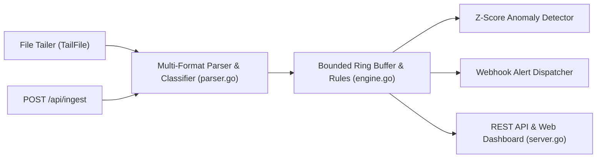

# LogSentry

Real-time log ingestion, multi-format parsing, error classification, statistical anomaly detection, and alerting platform written in Go.

## Purpose & Problem Statement

Server and application logs arrive in heterogeneous formats (structured JSON, Nginx/Apache Combined access logs, Syslog RFC3164, unstructured text). Searching across formats manually or spotting sudden error spikes too late delays incident response. LogSentry ingests logs via real-time file tailing or HTTP JSON, normalizes entries, classifies failure types, detects statistical error bursts, dispatches webhook alerts, and archives log files with gzip compression.

## Features

- **Multi-Format Parser**: Automatically detects and parses JSON lines, Nginx/Apache Combined access logs, Syslog RFC3164, and timestamped application logs.
- **Real-Time Tailing & HTTP Ingestion**: Streams appended log lines via `TailFile` or accepts batched ingestion at `POST /api/ingest`.
- **Error Classification**: Categorizes log events into `http_5xx`, `http_4xx`, `auth_failure`, `timeout`, `database_error`, `crash`, `resource_exhaustion`, `general_error`, and `normal`.
- **Z-Score Anomaly Detection**: Compares the latest per-minute error bucket against baseline buckets and flags spikes exceeding `mean + 2 * stddev`.
- **Sliding-Window Alerts & Webhooks**: Evaluates threshold-per-window rules and dispatches JSON alert payloads to configured webhook URLs.
- **Time-Range Search, Archiving & Dashboard**: Query by time window (`from`/`to`), level, category, or substring; archive logs as `.gz`; and manage rules from the web UI.

## Tech Stack

- **Language**: Go 1.24 (`net/http`, `regexp`, `compress/gzip`, `sync`)
- **Dashboard**: Embedded HTML/JS (`go:embed`)

## System Requirements

- Go 1.24 or newer

## Installation

```bash
git clone https://github.com/fully-ai/logsentry.git
cd logsentry
go build -o logsentry ./cmd/logsentry
```

## Configuration & CLI Commands

| Command | Flags | Description |
| --- | --- | --- |
| `serve` | `-addr` (`127.0.0.1:8095`), `-file`, `-rules` | Start web dashboard, API, optional real-time file tailer, and JSON alert rules |
| `analyze` | `-file` | Parse a log file offline and print JSON summary statistics and anomaly status |
| `archive` | `-file`, `-dir` (`./archives`) | Compress a log file into `<dir>/<name>.<timestamp>.gz` |

## Running & Usage Examples

```bash
# Start dashboard + real-time file tailer
./logsentry serve -addr 127.0.0.1:8095 -file /var/log/app.log

# Ingest structured or raw lines over HTTP
curl -s -X POST http://127.0.0.1:8095/api/ingest \
  -H 'Content-Type: application/json' \
  -d '{"source":"auth-svc","lines":["2026-11-16T10:00:00Z ERROR Authentication failed for admin"]}'

# Query errors in a time range
curl -s "http://127.0.0.1:8095/api/logs?level=ERROR&from=2026-11-16T09:59:00Z"

# Archive a rotated log file
./logsentry archive -file /var/log/app.log -dir ./archives
```

## API Documentation

| Method & Path | Description |
| --- | --- |
| `GET /` | Embedded web dashboard with rule builder and time-range filters |
| `GET /api/health` | Service status |
| `POST /api/ingest` | Ingest `{source, lines[]}` batch |
| `GET /api/logs` | Query entries (`level`, `category`, `q`, `from`, `to`, `limit`) |
| `GET /api/stats` | Level/category/format counts and z-score anomaly status |
| `GET /api/alerts` | Fired sliding-window alert events |
| `POST /api/rules` | Register an alert rule (`name`, `level`, `category`, `pattern`, `threshold`, `window_sec`, `webhook_url`) |

## Architecture



## File Structure

```
logsentry/
├── cmd/logsentry/main.go        # serve, analyze, and archive CLI subcommands
├── internal/
│   ├── logs/
│   │   ├── types.go             # Entry, Query, AlertRule, AlertEvent
│   │   ├── parser.go            # JSON, Nginx/Apache, Syslog RFC3164, generic parsers
│   │   ├── engine.go            # Ring buffer, rules, anomaly detector, tailer, gzip archiver
│   │   └── engine_test.go       # Parser, anomaly, webhook, tailing, archive tests
│   └── api/
│       ├── server.go            # HTTP handlers
│       ├── server_test.go       # Ingestion, time-range query, and rule validation tests
│       └── index.html           # Dashboard + rule creator UI
├── docs/architecture.md
├── Dockerfile
└── compose.yaml
```

## Testing

```bash
go vet ./...
go test -v -race ./...
```

## Docker Deployment

```bash
docker compose up -d --build
```

## Security Notes

- Request payloads are bounded via `http.MaxBytesReader` (2 MiB on `/api/ingest`, 64 KiB on `/api/rules`).
- Binds to `127.0.0.1` by default; place behind reverse-proxy authentication before external exposure.

## Known Limitations

- Log entries are retained in a bounded in-memory ring buffer (`20,000` entries by default); long-term storage relies on `.gz` archiving via `logsentry archive`.

## Contributing

See [CONTRIBUTING.md](CONTRIBUTING.md) and [CODE_OF_CONDUCT.md](CODE_OF_CONDUCT.md).

## License

Apache License 2.0 — see [LICENSE](LICENSE).
